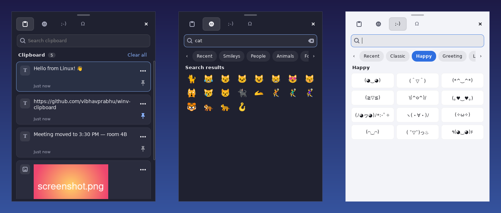
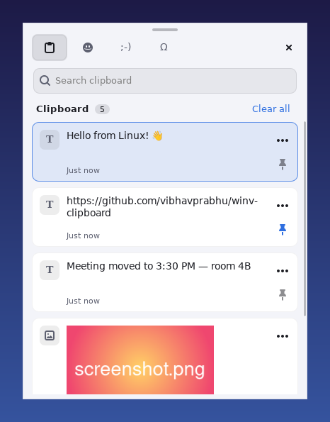
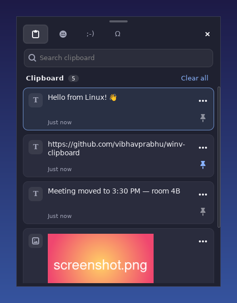
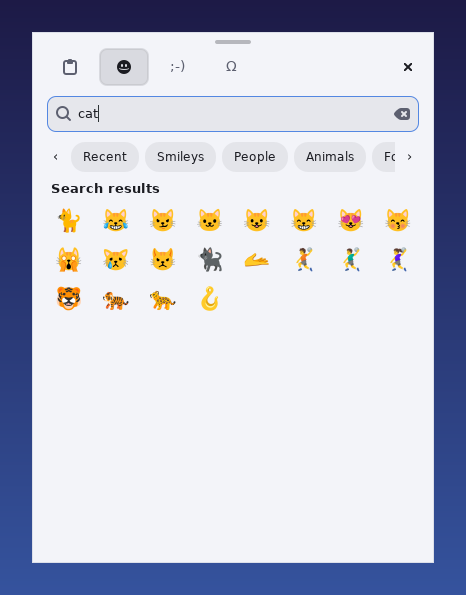
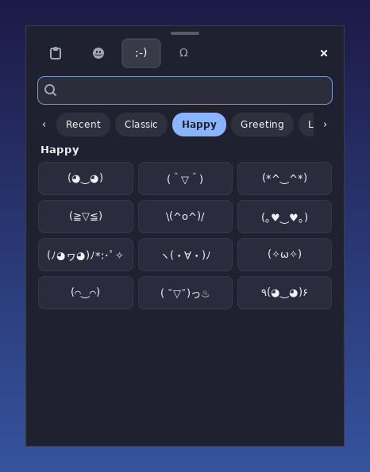
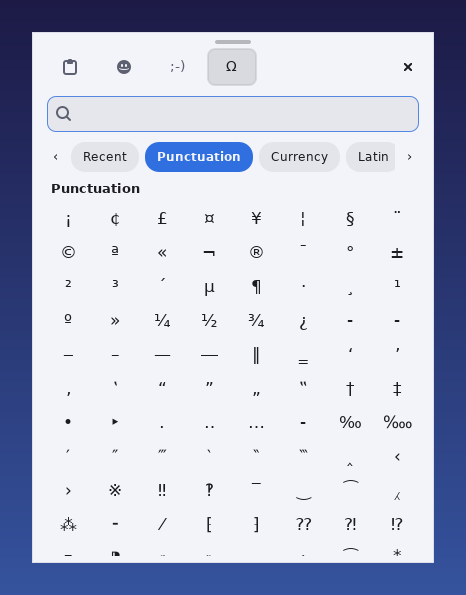
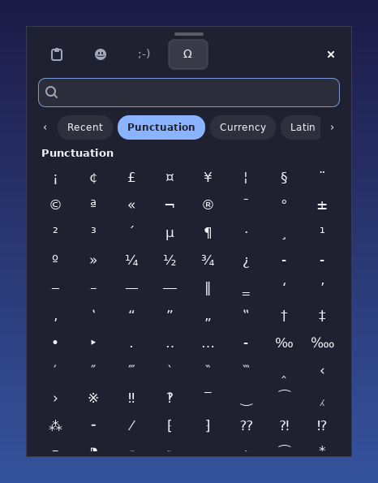

<div align="center">

# 📋 winv

**The Windows 11 clipboard history (Win+V) and emoji panel, for Linux.**

[](#-install)
[](#-for-developers)
[](dist/)

<a href="https://www.buymeacoffee.com/vibhavprabhu"></a>



</div>

---

## ⚡ Quick start

Debian, Ubuntu, Linux Mint, Pop!_OS, Zorin, elementary:

```bash
wget https://github.com/vibhavprabhu/winv-clipboard/raw/main/dist/winv_1.2.0_all.deb
sudo apt install ./winv_1.2.0_all.deb
winv &          # or just log out and back in: winv starts with your session
```

Then press <kbd>Super</kbd> + <kbd>V</kbd>.

Fedora, Arch, openSUSE and others:

```bash
git clone https://github.com/vibhavprabhu/winv-clipboard.git
cd winv-clipboard
sudo ./install.sh
```

---

## 🌟 Features

| | |
| --- | --- |
| 📋 **Clipboard history** | The last 25 texts and images you copied, newest first, with when you copied them. |
| ⚡ **Paste in one click** | Pick an entry and it is pasted straight into the app you were using (Ctrl+Shift+V in terminals). |
| 📌 **Pin** | Pinned entries stay through "Clear all" and restarts. |
| 🔍 **Search** | Start typing to filter the clipboard, emoji, kaomoji or symbols. |
| 😊 **Emoji picker** | Every emoji with names and keywords, grouped like Windows, with a "Recently used" row. |
| ;-) **Kaomoji** | `¯\_(ツ)_/¯`, `(╯°□°)╯︵ ┻━┻` and friends, grouped by mood. |
| Ω **Symbols** | Punctuation, currency, Latin, Greek, math, arrows and shapes. |
| 🌗 **Light and dark** | Windows 11 colours that follow your desktop's theme. |
| 🔒 **Private** | Nothing leaves your computer. Password-manager copies are skipped, and only pinned entries are written to disk. |

Inserting an emoji, kaomoji or symbol does not end up in your clipboard
history, and your previous clipboard comes back right after, just like on
Windows.

---

## 📸 Screenshots

| Light | Dark |
| --- | --- |
|  |  |
|  |  |
|  |  |

---

## ⌨️ Shortcuts

| Keys | Action |
| --- | --- |
| <kbd>Super</kbd> + <kbd>V</kbd> | Open / close clipboard history |
| <kbd>Ctrl</kbd> + <kbd>Alt</kbd> + <kbd>V</kbd> | Same, for desktops where Super+V is taken |
| <kbd>Super</kbd> + <kbd>.</kbd> | Open the emoji picker |
| <kbd>↑</kbd> <kbd>↓</kbd> then <kbd>Enter</kbd> | Paste the selected entry |
| Just type | Search the open tab |
| <kbd>Delete</kbd> | Remove the selected clipboard entry |
| <kbd>Esc</kbd> | Clear the search, then close |

On the clipboard tab, **Clear all** removes everything except pinned entries.
The **…** button on an entry deletes just that one.

The panel opens on the monitor your mouse is on. Drag it by its top bar to put
it somewhere else; winv remembers that spot separately for each monitor.

### How the shortcuts are set up

- **GNOME, Ubuntu, Budgie, Pop!_OS:** set up automatically the first time winv
  starts. GNOME normally uses Super+V for the notification list; that stays
  available on Super+M. `winv --remove-hotkey` undoes everything.
- **Xfce, Cinnamon, MATE, LXQt, i3, Openbox and other X11 desktops:** winv
  catches the keys itself; nothing to configure.
- **KDE Plasma:** Meta+V belongs to Plasma's own clipboard. Use
  <kbd>Ctrl</kbd>+<kbd>Alt</kbd>+<kbd>V</kbd>, or swap Meta+V to `winv --toggle`
  in System Settings → Shortcuts.
- **Sway, Hyprland and other Wayland compositors:** bind the commands yourself,
  for example `bindsym Mod4+v exec winv --toggle` and
  `bindsym Mod4+period exec winv --emoji`.

---

## 🛠️ Troubleshooting

**Some kaomoji show as empty boxes.** Install a CJK font:
`sudo apt install fonts-noto-cjk` (Ubuntu, Mint and Pop!_OS already include it).

**Emoji show in black and white.** Install `fonts-noto-color-emoji` (the `.deb`
pulls it in automatically).

**Picking an entry doesn't paste on Wayland.** Wayland doesn't let apps send
keystrokes freely. Install `wtype` (Sway, Hyprland, KDE) or `ydotool` with the
`ydotoold` service running (GNOME). Without them the entry still goes onto the
clipboard and you press <kbd>Ctrl</kbd>+<kbd>V</kbd> yourself. On X11 pasting is
always automatic.

**Super+V does nothing.** Check that winv is running (`winv &`), then run
`winv --setup-hotkey` on GNOME, or bind `winv --toggle` in your desktop's
keyboard settings.

**Windows Subsystem for Linux (WSL).** winv starts and records the clipboard,
but with Windows display scaling above 100% WSL sends mouse clicks to the wrong
place in Linux windows. Use a real Linux install or a virtual machine to try it.

---

## ⚙️ Settings

Optional file `~/.config/winv/config.json`:

```json
{
  "max_items": 25,
  "persist_history": false,
  "auto_paste": true,
  "theme": "auto"
}
```

- `theme`: `auto` (follow the desktop), `dark` or `light`.
- `persist_history`: `true` keeps the whole history across restarts, not only
  pinned entries.
- `auto_paste`: `false` only puts the chosen entry on the clipboard.

Restart winv after changing it: `winv --quit; winv &`.

---

## 💻 Commands

```text
winv                  start the background service
winv --toggle         show / hide clipboard history
winv --emoji          show / hide the emoji picker
winv --clear          remove everything that is not pinned
winv --quit           stop the service
winv --setup-hotkey   bind Super+V, Ctrl+Alt+V and Super+. on GNOME
winv --remove-hotkey  undo that
```

Pinned entries live in `~/.local/share/winv/` and recently used emoji in
`~/.config/winv/recent.json`, readable only by you. Delete
`~/.config/winv/position.json` to forget where you dragged the panel.

---

## 👩‍💻 For developers

winv is a single Python 3 file (`src/winv`) using GTK 3, with `xdotool` for
pasting on X11.

```bash
./build-deb.sh        # builds dist/winv_<version>_all.deb (needs dpkg-deb)
```

Ideas for the emoji, kaomoji and symbol tabs were inspired by
[Windows 11 Clipboard History For Linux](https://github.com/gustavosett/Windows-11-Clipboard-History-For-Linux)
by gustavosett.

---

## ☕ Support

If winv saves you time, you can
[buy me a coffee](https://www.buymeacoffee.com/vibhavprabhu). Thank you!
